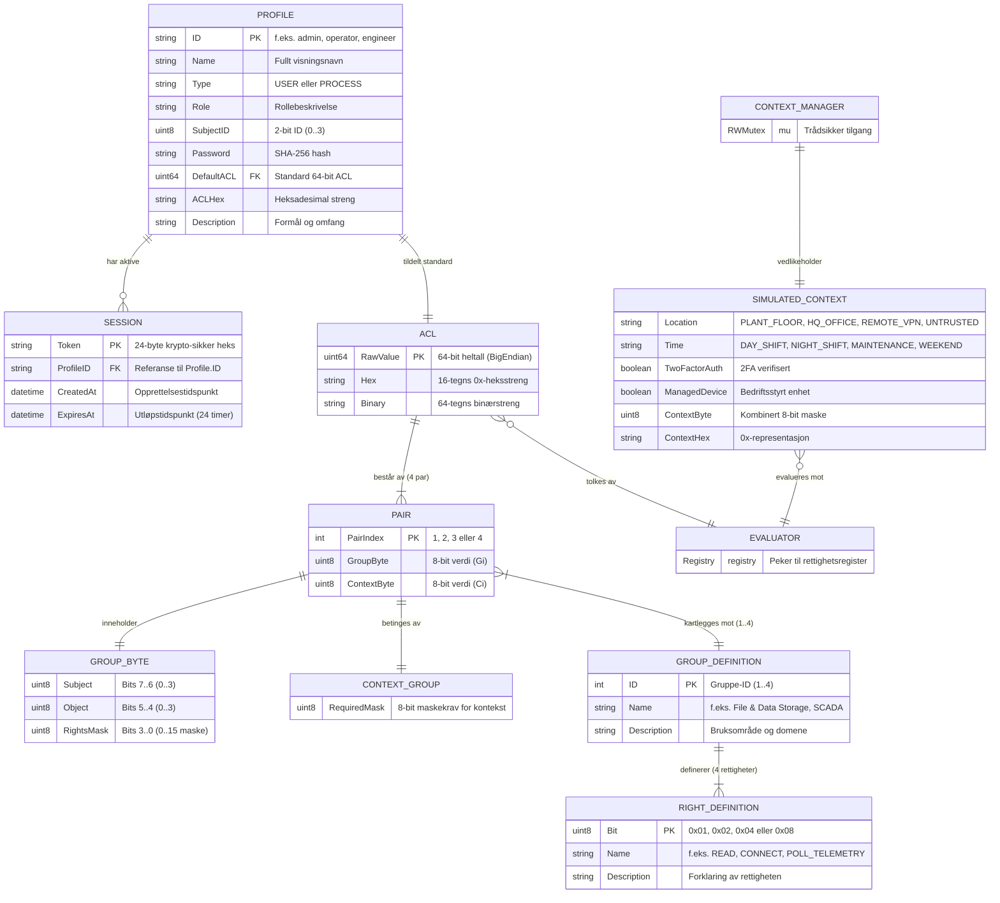
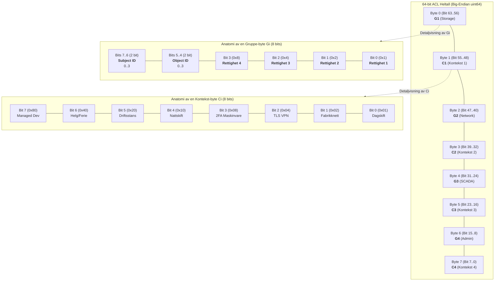
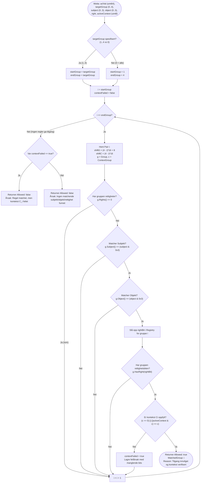
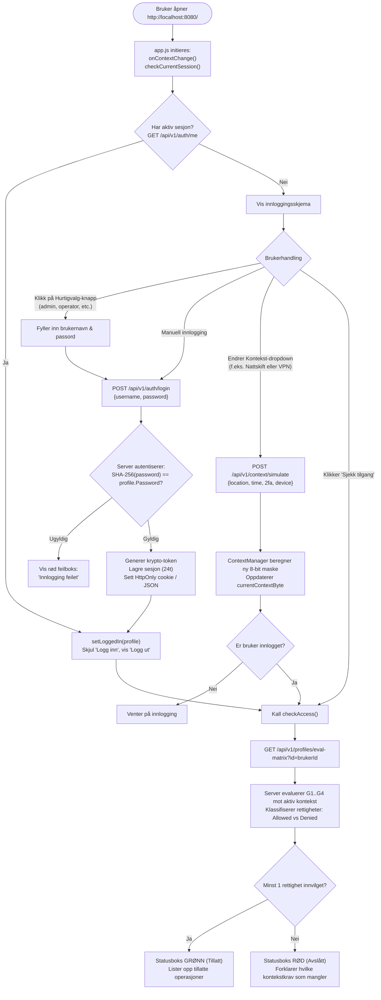
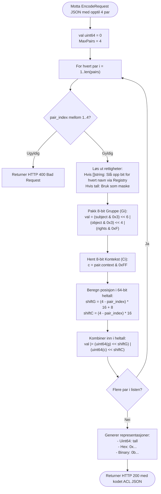
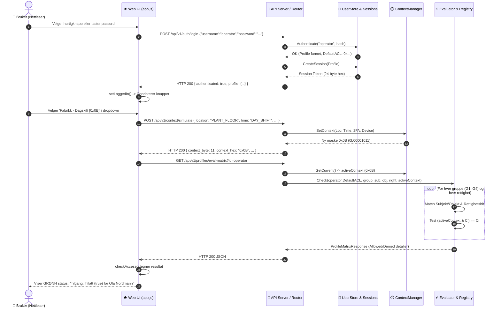
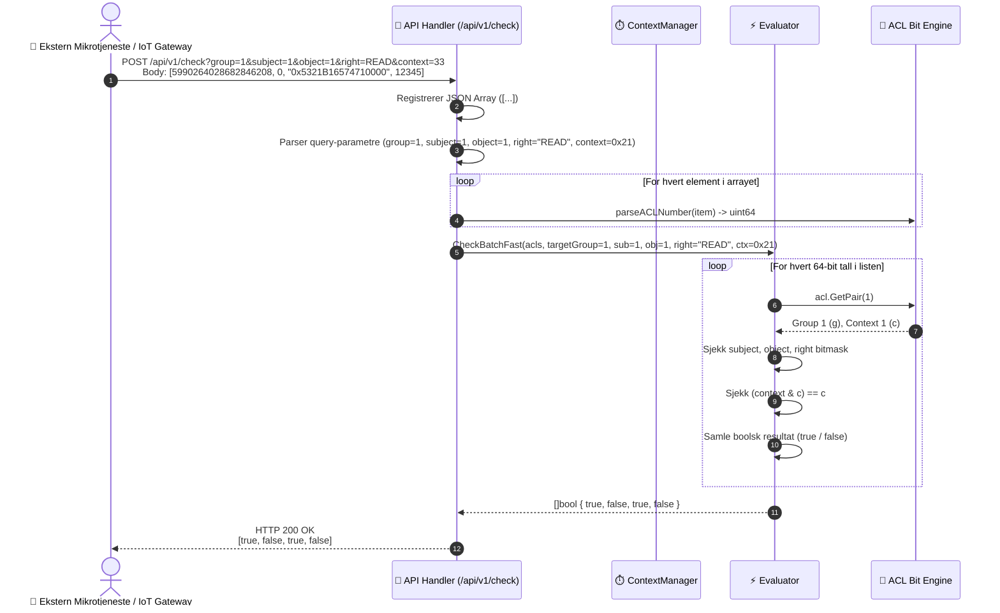
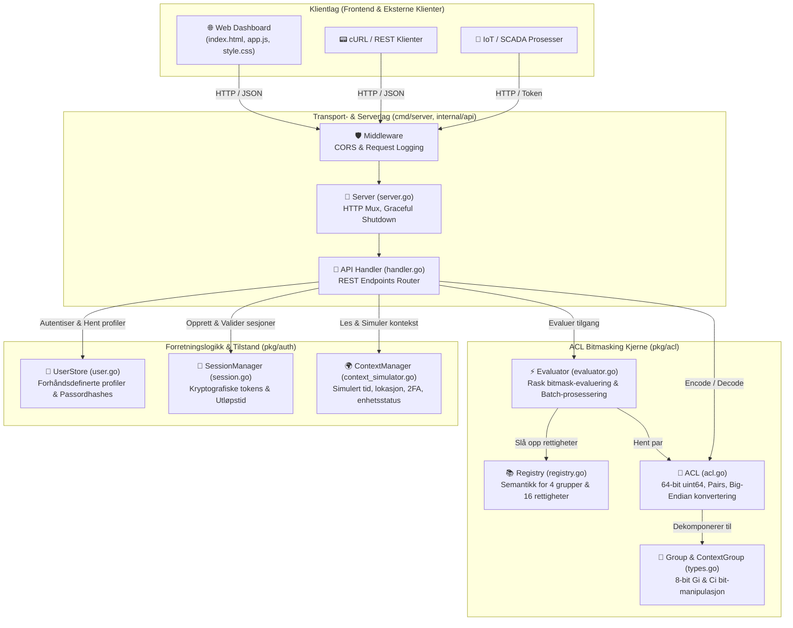
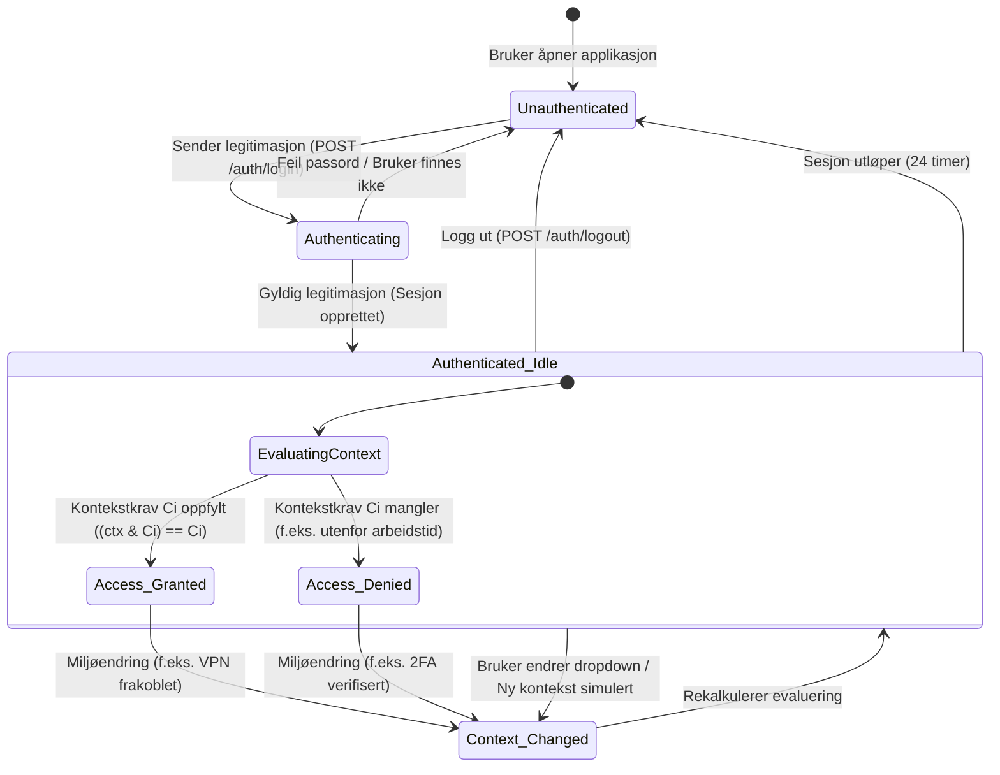

# Systemdiagrammer: 64-bit ABAC/ACL AuthSystem i Go

Dette dokumentet inneholder en komplett og ryddig samling av tekniske diagrammer for prosjektet [`ABAC-ACL-AuthSystemInGo-main`](file:///C:/dev/ABAC-ACL-AuthSystemInGo-main/ABAC-ACL-AuthSystemInGo-main). Diagrammene er utformet med **Mermaid** og dekker datamodell (ER), use cases, prosess- og evalueringsflyt, sekvenser, systemarkitektur og tilstander.

---

## Innholdsfortegnelse
1. [Oversikt over systemet](#1-oversikt-over-systemet)
2. [ER-diagram (Entity-Relationship & Datamodell)](#2-er-diagram-entity-relationship--datamodell)
3. [64-bit Bitmask & Minnelayout Diagram](#3-64-bit-bitmask--minnelayout-diagram)
4. [Use Case-diagram](#4-use-case-diagram)
5. [Flytdiagrammer (Flowcharts)](#5-flytdiagrammer-flowcharts)
   - [Flyt 1: Evaluering av tilgang (Evaluator Engine)](#flyt-1-kjerneevaluering-av-tilgang-evaluator-engine)
   - [Flyt 2: Webgrensesnitt og Kontekst-simulering](#flyt-2-webgrensesnitt-innlogging-og-kontekst-simulering)
   - [Flyt 3: ACL Encode (Bygging av 64-bit heltall)](#flyt-3-acl-encode-bygging-av-64-bit-heltall)
6. [Sekvensdiagrammer](#6-sekvensdiagrammer)
   - [Sekvens 1: Innlogging og dynamisk tilgangssjekk i Web UI](#sekvens-1-innlogging-og-dynamisk-tilgangssjekk-i-web-ui)
   - [Sekvens 2: Ekstern Batch-sjekk over REST API](#sekvens-2-ekstern-batch-sjekk-over-rest-api)
7. [Systemarkitektur & Komponentdiagram](#7-systemarkitektur--komponentdiagram)
8. [Tilstandsdiagram (State Diagram)](#8-tilstandsdiagram-state-diagram)

---

## 1. Oversikt over systemet

Systemet kombinerer to autorisasjonsmodeller:
- **ACL (Access Control List)** komprimert til et **64-bit heltall (`uint64`)** fordelt på 4 par `(Gi, Ci)`.
- **ABAC (Attribute-Based Access Control)** der kontekst $C_i$ (tid, lokasjon, nettverk, 2FA, enhetsstatus) kreves oppfylt for at rettighetene i gruppe $G_i$ skal være aktive:
  $$\text{Tilgang innvilget} \iff (G_i \text{ matcher Subjekt, Objekt og Rettighet}) \land ((C_i == 0) \lor (\text{AktivKontekst} \land C_i == C_i))$$

---

## 2. ER-diagram (Entity-Relationship & Datamodell)

Diagrammet nedenfor viser de logiske entitetene, deres felt og relasjoner mellom brukere, sesjoner, ACL-strukturer og rettighetsregistre.

---

## 3. 64-bit Bitmask & Minnelayout Diagram

Diagrammet nedenfor visualiserer hvordan et 64-bits `uint64`-heltall er nøyaktig pakket i minnet som fire par av `(Gi, Ci)` (totalt 8 bytes / 64 bits), samt den interne anatomien i hver byte.

### Grupperettigheter Semantikk (Tabell)

| Gruppe | Domene | Bit 0 (`0x1`) | Bit 1 (`0x2`) | Bit 2 (`0x4`) | Bit 3 (`0x8`) |
|---|---|---|---|---|---|
| **G1** | **File & Data Storage** | `READ` | `WRITE` | `EXECUTE` | `DELETE` |
| **G2** | **Network & Messaging** | `CONNECT` | `PUBLISH` | `SUBSCRIBE` | `DISCONNECT` |
| **G3** | **SCADA & Hardware** | `POLL_TELEMETRY` | `SET_ACTUATOR` | `CALIBRATE` | `EMERGENCY_STOP` |
| **G4** | **Admin & Security** | `VIEW_AUDIT` | `MANAGE_ROLES` | `CONFIG_SYSTEM` | `OVERRIDE` |

---

## 4. Use Case-diagram

Diagrammet viser de ulike aktørene (Operatør, Ingeniør, Administrator, Bakgrunnsprosesser og Eksternt API) og deres interaksjon med systemet.

```mermaid
graph TD
    %% Aktører
    subgraph Aktorer["Aktører"]
        User["👤 Sluttbruker<br/>(Operatør / Ingeniør / Gjest)"]
        Admin["👑 Administrator<br/>(System & Sikkerhet)"]
        Daemon["⚙️ Bakgrunnsprosess<br/>(SCADA Poller / Backup Worker)"]
        ExtAPI["💻 Ekstern Klient / API-konsument<br/>(Microservice / Gateway)"]
    end

    %% Use Cases
    subgraph Auth_Cases["Autentisering & Sesjon"]
        UC_Login(["UC1: Logge inn med brukernavn & passord"])
        UC_QuickFill(["UC1.1: Hurtigvalg av testbrukere"])
        UC_SessionCheck(["UC2: Verifisere aktiv sesjon (auth/me)"])
        UC_Logout(["UC3: Logge ut og invalidere token"])
    end

    subgraph Context_Cases["ABAC Kontekststyring"]
        UC_SimContext(["UC4: Simulere driftskontekst via dropdown"])
        UC_ViewContext(["UC5: Inspisere aktiv kontekstmaske (context/current)"])
    end

    subgraph Eval_Cases["ACL Tilgangsevaluering"]
        UC_EvalMatrix(["UC6: Evaluere full tilgangsmatrise for profil"])
        UC_CheckSingle(["UC7: Forespørre enkelt tilgangssjekk (/check)"])
        UC_CheckBatch(["UC8: Kjøre batch-evaluering av tall-liste (/check-batch)"])
        UC_VerifySubObj(["UC9: Validere Subjekt- og Objekt-ID"])
        UC_VerifyContext(["UC10: Evaluere kontekstkrav (C_i oppfylt)"])
    end

    subgraph Encode_Cases["ACL Verktøy & Administrasjon"]
        UC_Decode(["UC11: Dekode 64-bit ACL til lesbart format (/decode)"])
        UC_Encode(["UC12: Bygge 64-bit ACL fra regler (/encode)"])
        UC_ListGroups(["UC13: Hente gruppesemantikk (/groups)"])
    end

    %% Relasjoner for Bruker
    User --> UC_Login
    User --> UC_QuickFill
    User --> UC_Logout
    User --> UC_SimContext
    User --> UC_EvalMatrix
    User --> UC_CheckSingle

    %% Relasjoner for Admin
    Admin --> UC_Login
    Admin --> UC_Encode
    Admin --> UC_Decode
    Admin --> UC_ListGroups
    Admin --> UC_EvalMatrix

    %% Relasjoner for Daemon
    Daemon --> UC_CheckSingle
    Daemon --> UC_ViewContext

    %% Relasjoner for Ekstern API
    ExtAPI --> UC_CheckSingle
    ExtAPI --> UC_CheckBatch
    ExtAPI --> UC_Decode
    ExtAPI --> UC_Encode

    %% Inkluderings- og utvidelsesrelasjoner
    UC_QuickFill -.->|include| UC_Login
    UC_EvalMatrix -.->|include| UC_VerifySubObj
    UC_EvalMatrix -.->|include| UC_VerifyContext
    UC_CheckSingle -.->|include| UC_VerifySubObj
    UC_CheckSingle -.->|include| UC_VerifyContext
    UC_CheckBatch -.->|include| UC_CheckSingle
    UC_SimContext -.->|trigger| UC_EvalMatrix
```

---

## 5. Flytdiagrammer (Flowcharts)

### Flyt 1: Kjerneevaluering av tilgang (Evaluator Engine)

Dette flytdiagrammet viser den eksakte logikken i [`Evaluator.Check`](file:///C:/dev/ABAC-ACL-AuthSystemInGo-main/ABAC-ACL-AuthSystemInGo-main/pkg/acl/evaluator.go#L39-L113) når en tilgangssjekk utføres mot et 64-bit ACL-tall.

---

### Flyt 2: Webgrensesnitt: Innlogging og Kontekst-simulering

Viser hendelsesforløpet i nettleseren og serveren fra brukeren åpner siden til tilgang evalueres dynamisk.

---

### Flyt 3: ACL Encode (Bygging av 64-bit heltall)

Viser hvordan høynivå JSON-spesifikasjon med par, subjekter, objekter og rettighetsnavn pakkes til et `uint64`-heltall i [`HandleEncode`](file:///C:/dev/ABAC-ACL-AuthSystemInGo-main/ABAC-ACL-AuthSystemInGo-main/internal/api/handler.go#L446-L514).

---

## 6. Sekvensdiagrammer

### Sekvens 1: Innlogging og dynamisk tilgangssjekk i Web UI

---

### Sekvens 2: Ekstern Batch-sjekk over REST API

Viser hvordan en ekstern mikrotjeneste sender en liste med 64-bit ACL-tall for umiddelbar batch-evaluering.

---

## 7. Systemarkitektur & Komponentdiagram

Dette diagrammet viser modulene og avhengighetene i Go-applikasjonen, strukturert etter lag (Clean Architecture).

---

## 8. Tilstandsdiagram (State Diagram)

Diagrammet illustrerer tilstandsovergangene for en brukersesjon i systemet, og hvordan dynamisk kontekst fører til overgang mellom innvilget tilgang (`Access_Granted`) og avslått tilgang (`Access_Denied`).

---

## 9. Oppsummering og Anbefalinger

1. **Ytelse:** ACL-sjekken er optimalisert med rene bitvise operasjoner (`&`, `>>`, `|`), noe som gir sub-mikrosekund evalueringstid selv ved tusenvis av samtidige batch-kall.
2. **Kompakthet:** Hele sikkerhetspolicyn for et subjekt på tvers av 4 uavhengige grupper og kontekster lagres i ett enkelt 64-bits heltall (8 bytes).
3. **ABAC-integrasjon:** Kontekstbetingelsen $C_i$ sikrer at rettigheter aldri er statiske, men til enhver tid krever verifisert lokasjon, tid og tofaktorautentisering.
