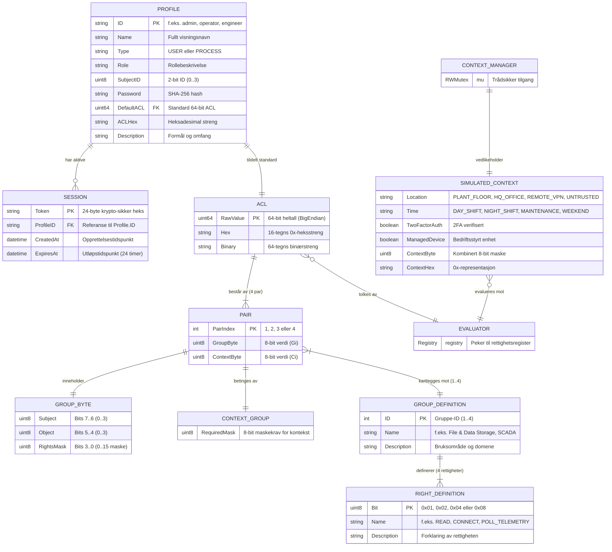
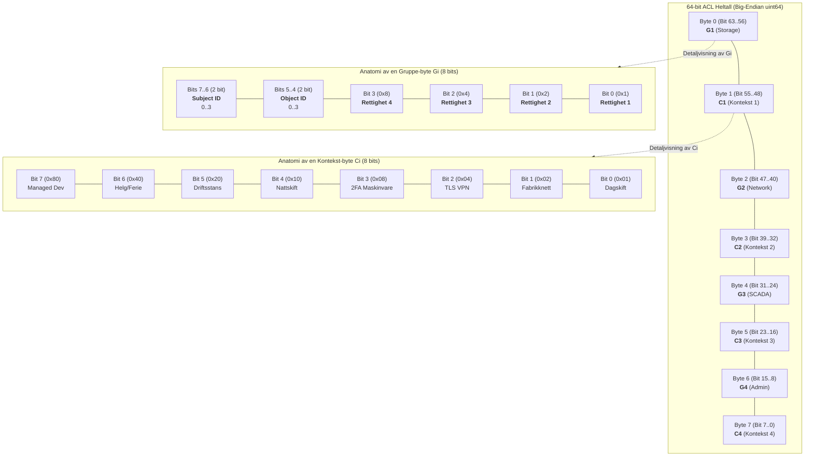
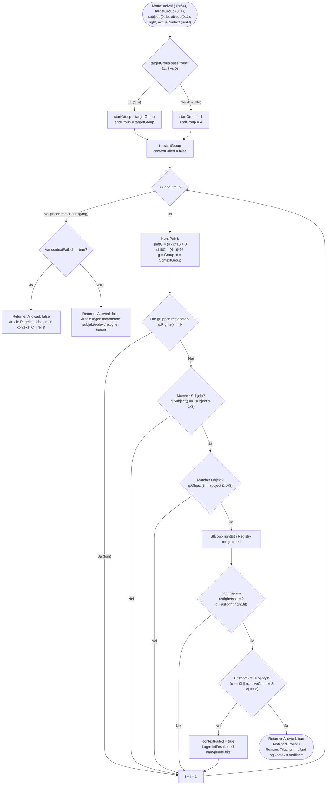
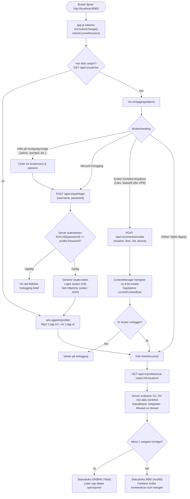
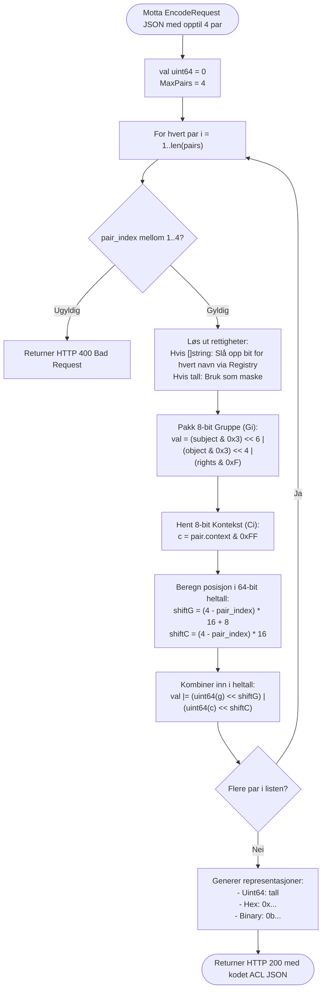
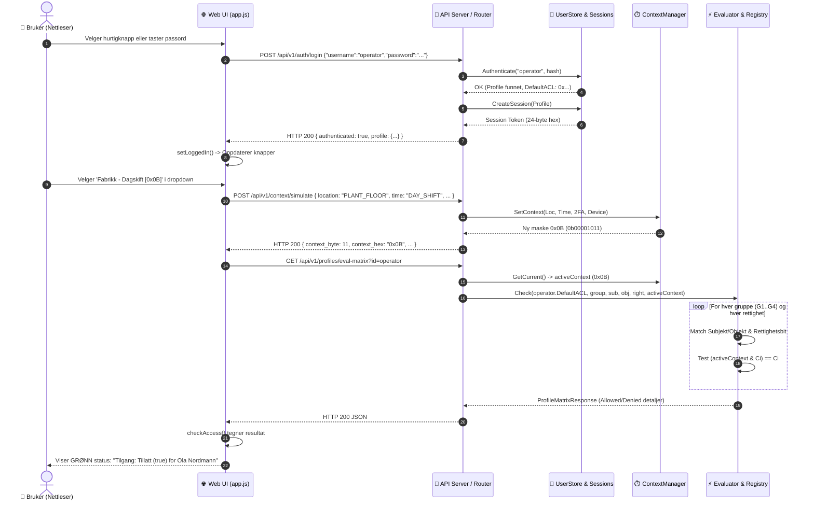
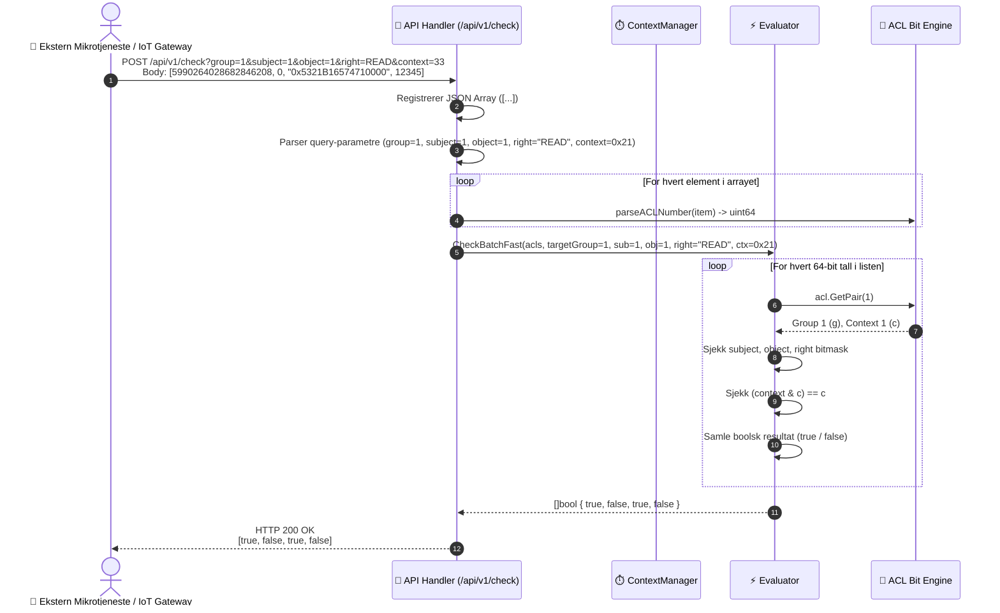
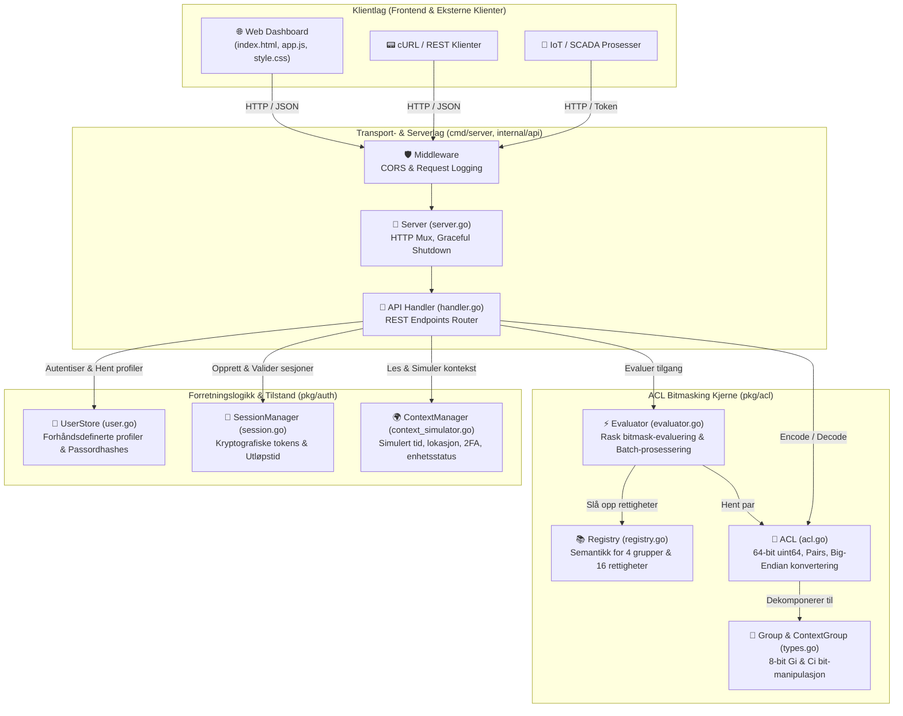
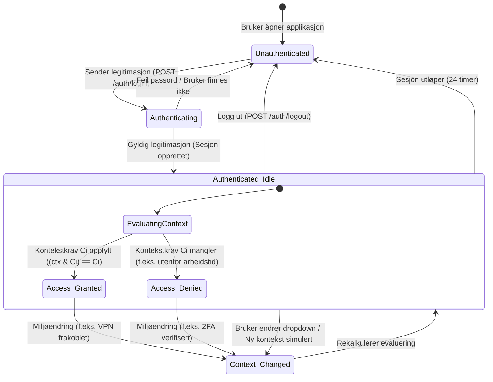

# 64-bit ACL Bitmask Engine (Go Server)

Et komplett tilgangskontrollsystem (ACL) skrevet i Go, basert på **64-bit heltall og bitmasking**.


> **Merk om HTML-grensesnittet:**  
> Webgrensesnittet på **http://localhost:8080** er bevisst bygget helt minimalistisk og rent. HTML-koden viser **KUN innloggingsskjema + knapper og 1 dropdown-meny for kontekst-simulering**. Det er ingen ekstra faner, ingen symboler og ingen unødvendig kompleksitet.

---

## 📑 Innholdsfortegnelse
- [Webgrensesnitt](#-webgrensesnitt-kun-login--knapper--1-dropdown)
- [Kjøring med Docker](#-kjøring-med-docker)
- [Forhåndsdefinerte Brukere og Passord](#-forhåndsdefinerte-brukere-og-passord)
- [Falsk Kontekst-informasjon (Lokasjon & Tid)](#-falsk-kontekst-informasjon-lokasjon--tid)
- [Bit-Struktur og Bitmasking](#-bit-struktur-og-bitmasking)
- [System- og Arkitekturdiagrammer](#-system--og-arkitekturdiagrammer)
  - [1. ER-diagram (Entity-Relationship & Datamodell)](#1-er-diagram-entity-relationship--datamodell)
  - [2. 64-bit Bitmask & Minnelayout Diagram](#2-64-bit-bitmask--minnelayout-diagram)
  - [3. Use Case-diagram](#3-use-case-diagram)
  - [4. Flytdiagram 1: Kjerneevaluering av tilgang (Evaluator Engine)](#4-flytdiagram-1-kjerneevaluering-av-tilgang-evaluator-engine)
  - [5. Flytdiagram 2: Webgrensesnitt, Innlogging og Kontekst-simulering](#5-flytdiagram-2-webgrensesnitt-innlogging-og-kontekst-simulering)
  - [6. Flytdiagram 3: ACL Encode (Bygging av 64-bit heltall)](#6-flytdiagram-3-acl-encode-bygging-av-64-bit-heltall)
  - [7. Sekvensdiagram 1: Innlogging og dynamisk tilgangssjekk i Web UI](#7-sekvensdiagram-1-innlogging-og-dynamisk-tilgangssjekk-i-web-ui)
  - [8. Sekvensdiagram 2: Ekstern Batch-sjekk over REST API](#8-sekvensdiagram-2-ekstern-batch-sjekk-over-rest-api)
  - [9. Systemarkitektur & Komponentdiagram](#9-systemarkitektur--komponentdiagram)
  - [10. Tilstandsdiagram (State Diagram)](#10-tilstandsdiagram-state-diagram)
- [REST API Eksempler](#-rest-api-eksempler)

---

## 🖥️ Webgrensesnitt (Kun Login + Knapper + 1 Dropdown)

HTML-siden viser utelukkende følgende elementer:

1. **Innloggingsskjema:**
   - Tekstfelt for **Brukernavn**
   - Tekstfelt for **Passord**

2. **Knapper:**
   - **Logg inn** (endres til **Logg ut** når bruker er autentisert)
   - **Sjekk tilgang**
   - Hurtigvalg-knapper: `admin`, `operator`, `engineer`, `guest`

3. **1 Dropdown-meny (for kontekst-simulering):**
   - *Fabrikk - Dagskift (08:00 - 16:00, 192.168.1.x, 2FA) [Maske: 0x0B]*
   - *Fabrikk - Nattskift (22:00 - 06:00) [Maske: 0x12]*
   - *Hovedkontor - Dagskift (Oslo LAN) [Maske: 0x03]*
   - *Hjemmekontor / VPN - Arbeidstid (Kryptert tunnel, 2FA) [Maske: 0x0D]*
   - *Vedlikeholdsvindu (Planlagt driftsstans) [Maske: 0x20]*
   - *Helg / Helligdag (Stengt fabrikk) [Maske: 0x40]*
   - *Eksternt nettverk - Utenfor arbeidstid (Ukjent IP) [Maske: 0x00]*

4. **Resultatboks:**
   - Viser aktiv innlogget bruker, gjeldende kontekstmaske ($C$), og om tilgang evaluerer til **`Tillatt (true)`** eller **`Avslått (false)`**.

---

## 🐳 Kjøring med Docker

Serveren er klargjort for Docker med en multi-stage build (bygger med `golang:1.24-alpine` og kjører i minimal `alpine:3.21`).

### Start med Docker Compose (Anbefalt)
```bash
cd c:\dev\go-acl-bitmask
docker compose up --build -d
```

### Start direkte med Docker
```bash
docker build -t acl-bitmask-service .
docker run -d -p 8080:8080 --name acl-service acl-bitmask-service
```

### Lokal kjøring uten Docker (Go)
```bash
go test -v ./...
go build -o acl-server.exe ./cmd/server
.\acl-server.exe -port 8080 -static ./web/static
```

Dashboardet er tilgjengelig på: **http://localhost:8080**

---

## 👤 Forhåndsdefinerte Brukere og Passord

| Brukernavn | Passord | Type | Subject ID (`xx`) | Rolle & Beskrivelse |
|---|---|---|---|---|
| **`admin`** | `admin123` | USER | `3` (11) | **Systemadministrator:** Full tilgang på tvers av alle 4 grupper. |
| **`operator`** | `operator123` | USER | `1` (01) | **Ola Nordmann (Skiftoperatør):** Styrer prosess-aktuatorer i arbeidstid på fabrikkgulvet. |
| **`engineer`** | `engineer123` | USER | `2` (10) | **Kari Ingeniør (Automasjonsingeniør):** Kalibrering og scriptkjøring via VPN/LAN med 2FA. |
| **`guest`** | `guest123` | USER | `0` (00) | **Gjest / Revisor:** Kun lesetilgang til telemetri, ingen skrive- eller styringsrettigheter. |
| **`proc-scada-poller`** | *(token)* | PROCESS | `2` (10) | **daemon://scada-telemetry-poller:** Høyfrekvent polling av sensorer på internt nett. |
| **`proc-backup-worker`** | *(token)* | PROCESS | `1` (01) | **cron://database-backup-worker:** Nattlig arkiveringsjobb i vedlikeholdsvinduet. |

---

## 🌍 Falsk Kontekst-informasjon (Lokasjon & Tid)

Tilgangskontroll krever at kontekstgruppen $C_i$ er oppfylt for at gruppe $G_i$ skal gi rettigheter (`activeContext & Ci == Ci`). 
Gjennom den **enkle dropdown-menyen** i grensesnittet kan du simulere falsk kontekst for å teste om ACL-reglene godkjenner eller avviser tilgang:

```
Kontekstbyte C (8 bit):
Bit 0 (0x01): Arbeidstid / Day Shift (08:00 - 16:00)
Bit 1 (0x02): Fabrikkgulv Subnet (192.168.1.x) / HQ LAN
Bit 2 (0x04): Sikker TLS VPN-tunnel (Norge)
Bit 3 (0x08): Maskinvare 2FA Verifisert
Bit 4 (0x10): Nattskift (22:00 - 06:00)
Bit 5 (0x20): Vedlikeholdsvindu (Off-peak)
Bit 6 (0x40): Helg / Helligdag
Bit 7 (0x80): Godkjent Bedrifts-enhet
```

---

## 📐 Bit-Struktur og Bitmasking

### 1. Gruppe-representasjon (8 bits / 1 byte)
Hver gruppe $G$ består av 8 bit:
```
Bit:       7   6   5   4   3   2   1   0
Mønster: [  xx  ] [  yy  ] [   ----   ]
Betydning: Subject  Object    Rights Bitmask (4 rettigheter)
```
- **`xx` (Bits 7..6 - 2 bits):** Subject ID (`0..3`).
- **`yy` (Bits 5..4 - 2 bits):** Object ID (`0..3`).
- **`----` (Bits 3..0 - 4 bits):** 4-bit rettighetsmaske med distinkt betydning for hver gruppe.

### 2. 64-bit ACL Layout (G1 C1 G2 C2 G3 C3 G4 C4)
Et 64-bit heltall (`uint64`) inneholder 4 par (8 bytes):
```
Byte 0: G1 (Gruppe 1)      Byte 1: C1 (Kontekstgruppe 1)
Byte 2: G2 (Gruppe 2)      Byte 3: C2 (Kontekstgruppe 2)
Byte 4: G3 (Gruppe 3)      Byte 5: C3 (Kontekstgruppe 3)
Byte 6: G4 (Gruppe 4)      Byte 7: C4 (Kontekstgruppe 4)
```

> **Evalueringsregel:** Gruppe $G_i$ gir kun tilgang dersom tilhørende kontekst $C_i$ er oppfylt:  
> `(active_context & Ci) == Ci`

### 3. Gruppesemantikk (4 distinkte rettigheter per gruppe)

| Gruppe | Navn & Domene | Bit 0 (0x1) | Bit 1 (0x2) | Bit 2 (0x4) | Bit 3 (0x8) |
|---|---|---|---|---|---|
| **G1** | File & Data Storage | `READ` | `WRITE` | `EXECUTE` | `DELETE` |
| **G2** | Network & Messaging | `CONNECT` | `PUBLISH` | `SUBSCRIBE` | `DISCONNECT` |
| **G3** | SCADA & Hardware | `POLL_TELEMETRY` | `SET_ACTUATOR` | `CALIBRATE` | `EMERGENCY_STOP` |
| **G4** | Admin & Security | `VIEW_AUDIT` | `MANAGE_ROLES` | `CONFIG_SYSTEM` | `OVERRIDE` |

---

## 📊 System- og Arkitekturdiagrammer

### 1. ER-diagram (Entity-Relationship & Datamodell)

Viser de logiske entitetene, felt, nøkler og kardinalitet mellom brukere/prosesser, sesjoner, 64-bit ACL-verdier og rettighetsregistre.



---

### 2. 64-bit Bitmask & Minnelayout Diagram

Viser hvordan et 64-bits `uint64`-heltall er pakket i minnet (Big-Endian) som 4 par av $(G_i, C_i)$, samt bit-anatomien til $G_i$ og kontekstmasken $C_i$.



---

### 3. Use Case-diagram

Viser aktørene (*Operatør*, *Ingeniør*, *Administrator*, *Bakgrunnsprosess* og *Eksternt API*) og deres samhandling med systemet.

```mermaid
graph TD
    %% Aktører
    subgraph Aktorer["Aktører"]
        User["👤 Sluttbruker<br/>(Operatør / Ingeniør / Gjest)"]
        Admin["👑 Administrator<br/>(System & Sikkerhet)"]
        Daemon["⚙️ Bakgrunnsprosess<br/>(SCADA Poller / Backup Worker)"]
        ExtAPI["💻 Ekstern Klient / API-konsument<br/>(Microservice / Gateway)"]
    end

    %% Use Cases
    subgraph Auth_Cases["Autentisering & Sesjon"]
        UC_Login(["UC1: Logge inn med brukernavn & passord"])
        UC_QuickFill(["UC1.1: Hurtigvalg av testbrukere"])
        UC_SessionCheck(["UC2: Verifisere aktiv sesjon (auth/me)"])
        UC_Logout(["UC3: Logge ut og invalidere token"])
    end

    subgraph Context_Cases["ABAC Kontekststyring"]
        UC_SimContext(["UC4: Simulere driftskontekst via dropdown"])
        UC_ViewContext(["UC5: Inspisere aktiv kontekstmaske (context/current)"])
    end

    subgraph Eval_Cases["ACL Tilgangsevaluering"]
        UC_EvalMatrix(["UC6: Evaluere full tilgangsmatrise for profil"])
        UC_CheckSingle(["UC7: Forespørre enkelt tilgangssjekk (/check)"])
        UC_CheckBatch(["UC8: Kjøre batch-evaluering av tall-liste (/check-batch)"])
        UC_VerifySubObj(["UC9: Validere Subjekt- og Objekt-ID"])
        UC_VerifyContext(["UC10: Evaluere kontekstkrav (C_i oppfylt)"])
    end

    subgraph Encode_Cases["ACL Verktøy & Administrasjon"]
        UC_Decode(["UC11: Dekode 64-bit ACL til lesbart format (/decode)"])
        UC_Encode(["UC12: Bygge 64-bit ACL fra regler (/encode)"])
        UC_ListGroups(["UC13: Hente gruppesemantikk (/groups)"])
    end

    %% Relasjoner for Bruker
    User --> UC_Login
    User --> UC_QuickFill
    User --> UC_Logout
    User --> UC_SimContext
    User --> UC_EvalMatrix
    User --> UC_CheckSingle

    %% Relasjoner for Admin
    Admin --> UC_Login
    Admin --> UC_Encode
    Admin --> UC_Decode
    Admin --> UC_ListGroups
    Admin --> UC_EvalMatrix

    %% Relasjoner for Daemon
    Daemon --> UC_CheckSingle
    Daemon --> UC_ViewContext

    %% Relasjoner for Ekstern API
    ExtAPI --> UC_CheckSingle
    ExtAPI --> UC_CheckBatch
    ExtAPI --> UC_Decode
    ExtAPI --> UC_Encode

    %% Inkluderings- og utvidelsesrelasjoner
    UC_QuickFill -.->|include| UC_Login
    UC_EvalMatrix -.->|include| UC_VerifySubObj
    UC_EvalMatrix -.->|include| UC_VerifyContext
    UC_CheckSingle -.->|include| UC_VerifySubObj
    UC_CheckSingle -.->|include| UC_VerifyContext
    UC_CheckBatch -.->|include| UC_CheckSingle
    UC_SimContext -.->|trigger| UC_EvalMatrix
```



---

### 4. Flytdiagram 1: Kjerneevaluering av tilgang (Evaluator Engine)

Viser den eksakte logikken i `Evaluator.Check` når et 64-bits ACL-tall evalueres mot et mål.



---

### 5. Flytdiagram 2: Webgrensesnitt, Innlogging og Kontekst-simulering

Viser hendelsesforløpet i nettleseren og serveren fra åpning av siden til sanntids evaluering.



---

### 6. Flytdiagram 3: ACL Encode (Bygging av 64-bit heltall)

Viser hvordan JSON-regler for subjekter, objekter, rettighetsnavn og kontekstmasker kodes til et 64-bits `uint64`.



---

### 7. Sekvensdiagram 1: Innlogging og dynamisk tilgangssjekk i Web UI



---

### 8. Sekvensdiagram 2: Ekstern Batch-sjekk over REST API



---

### 9. Systemarkitektur & Komponentdiagram

Viser modulene og avhengighetene i Go-applikasjonen strukturert etter lag.



---

### 10. Tilstandsdiagram (State Diagram)

Viser tilstandsovergangene for brukersesjoner og dynamisk tilgangskontroll.



---

## 📡 REST API Eksempler

### 1. Enkelt Tilgangssjekk (Returnerer true eller false)
```bash
curl -X POST "http://localhost:8080/api/v1/check?raw=true&group=1&subject=1&object=1&right=READ&context=33" \
  -H "Content-Type: application/json" \
  -d '{"acl": 5990264028682846208}'
```
**Respons:**
```
true
```

### 2. Batch-sjekk: Send liste med tall &rarr; Få liste med true/false
```bash
curl -X POST "http://localhost:8080/api/v1/check?group=1&subject=1&object=1&right=READ&context=33" \
  -H "Content-Type: application/json" \
  -d '[5990264028682846208, 0, "0x5321B16574710000", 12345]'
```
**Respons:**
```json
[
  true,
  false,
  true,
  false
]
```

### 3. Dekode 64-bit ACL
```bash
curl "http://localhost:8080/api/v1/decode?acl=0x5321B16574710000"
```

### 4. Enkode / Bygge 64-bit ACL
```bash
curl -X POST http://localhost:8080/api/v1/encode \
  -H "Content-Type: application/json" \
  -d '{
    "pairs": [
      { "pair_index": 1, "subject": 1, "object": 1, "rights": ["READ", "WRITE"], "context": 33 },
      { "pair_index": 2, "subject": 2, "object": 3, "rights": ["CONNECT"], "context": 101 }
    ]
  }'
```